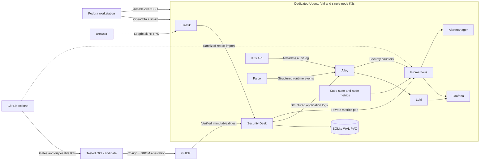

# Cloud-Native DevSecOps Lab

A local Kubernetes security lab built around **Security Desk**, a small application for recording findings and tracking remediation. Operators create findings and manage status. Reviewers can read findings. The same workload exercises build, policy, release, runtime, and recovery controls.

**Verified in the development sandbox** are the application request-handler and SQLite paths, HTTP parsing over local IPC, a backup restored to a separate database, TLS certificate issuance and hostname checking, manifest structure, CI report conversion, and the sanitized SOC export. The Kubernetes, GitHub Actions, container, runtime sensors, and live browser paths still require execution in an environment with those capabilities. See the [acceptance report](docs/assessment.md).

## Architecture



The guest profile assigns 4 vCPUs, 8 GiB of RAM, and a 24 GiB thin-provisioned disk. The public interface is a loopback port-forward. The workload uses native Kubernetes admission, restricted Pod Security Standards, denied-by-default pod networking, and separate application and metrics ports.

## Reproduce

Run the verified checks from the repository root with Node 22.23.1 or later in the 22.x line, Python with PyYAML, and OpenSSL.

```bash
npm ci --ignore-scripts --no-audit --no-fund
npm run check
npm test
python3 -m unittest discover -s tests -p '*_test.py' -v
scripts/verify-tls.sh
```

For VM creation, the locally signed Podman build, K3s deployment, evidence collection, and teardown, follow the [operator runbook](docs/runbook.md). Start on a host with KVM, writable libvirt access, rootless Podman, and outbound access to the specified upstream sources.

## Repository guide

- Application, REST endpoints, and tests. [app/](app/) · [tests/](tests/)
- OpenTofu VM, Ansible guest bootstrap, and the opt-in AWS security extension. [infra/](infra/) · [AWS mapping](docs/aws.md)
- Workload isolation, admission, and logging and monitoring configuration. [deploy/](deploy/)
- GitHub Actions gates, keyless release signing, and controlled promotion. [workflows](.github/workflows/)
- Operating assumptions, technology choices, and attack-surface review. [Architecture](docs/architecture.md) · [Threat model](docs/threat-model.md)
- Sanitized evidence, limitations, and weighted assessment. [Evidence](evidence/) · [Assessment](docs/assessment.md)
- Milestones and continuity. [Goals](GOALS.md) · [Plans](PLANS.md) · [Progress](PROGRESS.md) · [Handoff](HANDOFF.md)

The code is available under the [MIT License](LICENSE).
