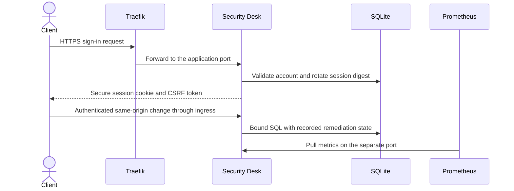

# Architecture and engineering decisions

## Trust boundaries

1. The Fedora workstation owns the dedicated libvirt state and private SSH, TLS, and Kubernetes client material. OpenTofu uses a separate VM, storage pool, and NAT bridge. Provisioning checks for resource name and subnet collisions.
2. The Ubuntu guest firewall accepts new SSH connections only from the lab bridge gateway on its uplink. Guest and forwarded traffic toward private IPv4 networks is blocked except for the lab's DNS forwarder. K3s ingress and administration reach the workstation through SSH and Kubernetes port-forwards.
3. The application namespace uses restricted Pod Security Standards and a native validating admission policy. The runtime service account has no workload permissions or token mount. The observer reads selected objects, and the promoter can get and patch one Deployment. Impersonated checks verify the intended authorization boundary when run against a cluster.
4. The application trusts Traefik for the TLS boundary. An unauthenticated client can reach the browser login page and health endpoints. Authentication is required for findings. Changes require the operator role, exact Origin, and a CSRF token bound to the session. The app has no pod egress. Traefik and Prometheus have independent namespace, pod, and destination-port selectors.
5. Observability and the runtime sensor use separate namespaces. Alloy is scoped to the Desk and Falco pod logs, with read-only access to the guest audit directory. Falco's kernel access is limited to the dedicated guest. Operational interfaces use ClusterIP services and operator-started loopback forwards.
6. Pull-request validation runs on disposable GitHub-hosted runners with read-only repository permissions. A protected main-branch job signs the exact tested image and SBOM with GitHub OIDC. A separate promotion workflow verifies the signer and attestation before admission and functional checks on another disposable cluster.

## Technology selection

| Choice | Role and trade-off |
| --- | --- |
| OpenTofu, libvirt and Ansible | Separate ownership of guest lifecycle and guest configuration. The pinned Ubuntu cloud image keeps reconciliation reproducible. The libvirt provider is pinned to its 0.8 configuration schema. |
| K3s and native NetworkPolicy | Integrated CNI and NetworkPolicy controller on a small node. A separate K3d cluster exercises those controls in CI without exposing the workstation to pull-request code. |
| ValidatingAdmissionPolicy | Native Kubernetes CEL rules enforce immutable image references, read-only roots, and API-token restrictions on Desk pods. Pod Security Admission enforces the Restricted profile. This avoids a separate admission webhook. Cosign signature identity is checked during promotion. |
| Podman and Docker | Rootless Podman fits the Fedora workstation. GitHub-hosted runners use their Docker engine and K3d. Both build the same digest-pinned Containerfile. |
| Node, SQLite and a static browser frontend | Node's standard library covers the API and password derivation. SQLite WAL supports a real persistent database and online snapshots at small scale. One replica owns the local-path volume. |
| GitHub Actions, Semgrep, Gitleaks and Trivy | Source, fixture, dependency, IaC, image, and deployment gates all block release on failure. SBOM generation runs before publication. |
| Cosign | A dedicated key verifies the local archive before it is imported. GitHub release signing uses the main-branch workflow identity, a transparency-backed signature, and a CycloneDX attestation. |
| Prometheus, Grafana, Alertmanager, Falco, Alloy and Loki | Standard telemetry interfaces cover workload state, guest capacity, runtime alerts, Kubernetes audit events, remediation and the most recent imported CI run. |

The application has zero third-party npm runtime dependencies. The image scanner covers installed operating-system packages. The standalone Node runtime is reviewed through its upstream release history and pinned base digest. Lock and review the chart releases during each lab refresh. The single VM and its storage limit continuity when the guest fails.

## Source references

- K3s server and built-in networking behavior. [Server options](https://docs.k3s.io/cli/server) · [Networking services](https://docs.k3s.io/networking/networking-services)
- Kubernetes admission policy behavior and enforcement binding. [Validating admission policy](https://kubernetes.io/docs/reference/access-authn-authz/validating-admission-policy/)
- Libvirt provider configuration used by this profile. [Pinned domain schema](https://raw.githubusercontent.com/dmacvicar/terraform-provider-libvirt/v0.8.3/website/docs/r/domain.html.markdown)
- Runtime driver and log-to-metrics processing. [Falco Helm setup](https://falco.org/docs/setup/kubernetes/) · [Alloy Loki processing](https://grafana.com/docs/alloy/latest/reference/components/loki/loki.process/)
- Password storage parameters and GitHub identity verification. [OWASP password storage](https://cheatsheetseries.owasp.org/cheatsheets/Password_Storage_Cheat_Sheet.html) · [Sigstore quickstart](https://docs.sigstore.dev/quickstart/quickstart-cosign/)
